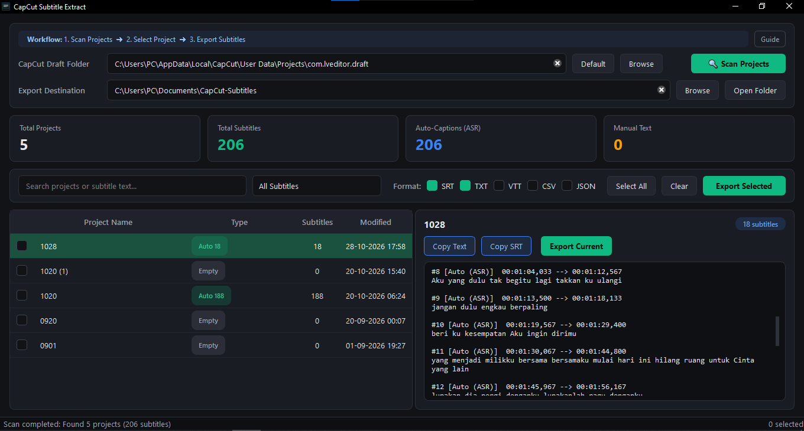

# CapCut Subtitle Extract

[](https://github.com/okkysatria/CapCut-Subtitle-Extract/releases/latest/download/CapCut-Subtitle-Extract.exe)

CapCut Subtitle Extract is a Windows desktop app for finding subtitles in CapCut Desktop project drafts. Preview and filter automatic captions and manually added text, copy them to the clipboard, or export them as SRT, VTT, TXT, CSV, and JSON files. The app reads local draft files and does not modify CapCut projects.

## Screenshots



## Features

### Scan and review projects

- Scan the default CapCut drafts folder or choose another folder.
- List projects with subtitle counts, caption types, and modification dates.
- Preview subtitle text and timecodes, with search across project names and subtitle text.
- Filter subtitles to show all text, automatic captions (ASR), or manual text.
- The selected subtitle filter applies to the preview, clipboard copies, and exported files.

### Copy and export subtitles

- Copy a clean transcript or SRT-formatted subtitles to the clipboard.
- Export one project or batch export selected projects.
- Choose SRT, VTT, TXT, CSV, or JSON output formats.
- Export text formats with UTF-8 encoding; CSV and text subtitle files use a UTF-8 BOM for compatibility with Windows and Excel.
- Cancel scans and exports while they are running.
- Choose and reopen the draft and export folders; the app remembers these paths and the window size.

## Project structure

```text
main.py                    Application entry point
core/
  capcut_core.py           Draft discovery, parsing, filtering, and export formats
gui/
  main_window.py           Main window and application interactions
  widgets.py               Spinner and statistic card widgets
workers/
  scan_worker.py           Background project scanner
  export_worker.py         Background subtitle exporter
styles/
  theme.py                 Dark application theme
assets/                    Application icons and logos
```

## Technology and requirements

- Python 3.10 or later
- PySide6 6.5 or later
- Windows 10 or 11 (64-bit) for scanning the default CapCut Desktop drafts location
- CapCut Desktop project drafts stored as readable JSON files

The default drafts folder is `%LOCALAPPDATA%\CapCut\User Data\Projects\com.lveditor.draft`; the default export folder is `%USERPROFILE%\Documents\CapCut-Subtitles`. Use **Default** to restore the draft location, or **Browse** to choose another folder. Drafts that cannot be read, including encrypted or invalid JSON files, are reported in the project preview. The app extracts text and subtitle tracks saved in the draft; it does not run speech recognition or alter the project.

## Run from source

Install the dependency and launch the application:

```bash
python -m pip install -r requirements.txt
python main.py
```

## Build a standalone executable

Install PyInstaller and build the Windows executable:

```bash
python -m pip install pyinstaller
pyinstaller --noconsole --onefile --name "CapCut-Subtitle-Extract" main.py
```

The executable is written to `dist/CapCut-Subtitle-Extract.exe`.
